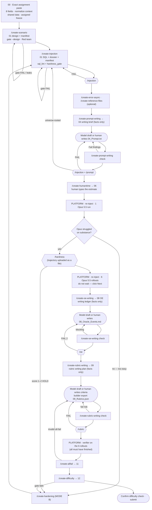

# How to Author a Task — Flow Guide (V3 assignments)

In Codex, invoke the authoring skills as `$create-*` with the same arguments as
the `/create-*` examples below. Run shell commands from the workspace root;
path conventions are in `setup/GEN_EXECUTION.md`.

This guide owns the **order, gates and loop-backs**. The playbooks own the method;
`setup/GEN_EXECUTION.md` owns the boundaries and the numbers. Platform screen
numbers refer to `references/Taxonomy_V2_Step_Map.md`.

## The shape of a V3 task

Four stages (`references/Docs/2_Overall Task Flow - V2.md`): **Build** the universe and
the prompt, **Validate** with `/injection`, `/prompt`, the Opus 5.5 pre-check and
`/hardness`, establish **Ground truth** (baseline, Oracle Events, rubric, human time)
and **Prove it** (verifier, all-fails, difficulty bands). One baseline run, one
verifier, no hinting. The universe carries the difficulty; the prompt is a short
trigger in the persona's voice.

This bundle front-loads the difficulty: **`/create-scenario` designs it** (storyline,
cohort spine, hidden authorities, delegation lattice, chains, traps, call budget) and
**`hardness_gate.py` verifies it** before and after the SQL exists, so a task that only
*claims* to be hard is caught before any platform run (`setup/GEN_EXECUTION.md` §3a).

Rounded nodes are writing or platform steps (Claude, Codex or the human). Hexagons are Eval Portal reviews handled by the user. **Every `/create-*` node ends at its stage
gate**: `python3 Task_Authoring/tools/stage_gate.py <stage> Task_Authoring/task_inputs --paste` must print PASS
before the arrow out of that node is taken, and the next node's gate refuses an upstream artifact whose pasted
PASS block is missing or stale (`setup/GEN_EXECUTION.md` § 6b). A prompt or universe
change after the baseline means re-injecting and re-running the baseline, then
re-checking everything downstream.

## Who writes what

The model drafting allowance below is the preserved repository exception to the
official V3 human-authorship rule. Existing Long→extreme targets (including ≥500
necessary calls) and Normal profile limits are also preserved local design choices;
assigned Easy/Medium/Hard changes the measured score cap, not the profile.

| Artifact | Written by | The harness's part |
|---|---|---|
| Scenario design, hardness manifest, injection SQL, grounding dossier | **Model** (harness) | builds them; gates verify against the SQL and the base universe |
| Reference files, error/async config, human-time worksheet, all-fail justifications, difficulty stats, hardening report | **Model** (harness) | builds them; stage gates check them |
| **Prompt** (`04_Prompt.txt`) | **Claude, Codex or human** | `/create-prompt-writing` gives the brief; `draft` writes the prompt; `check` reports defects with suggested wording |
| **Oracle Events** (`08_Oracle_Events.md`) | **Claude, Codex or human** | `/create-oe-writing` gives a verified fact ledger; `draft` writes the events; `check` reports defects |
| **Rubric criteria** (`09_Rubrics.json`) | **Claude, Codex or human** | `/create-rubric-writing` gives a coverage plan; `draft` writes the criteria; `check` reports defects |

## Toolbox — what to run when

| When | Run | Why |
|---|---|---|
| Before designing anything | `persona_view.py reach <persona>` · `entity.py resolve/collisions` · read `references/universe_kb/` (timeline, cohorts, trap_catalog, coherence_hazards, activity, integrations, conventions) | Know what the persona can see, who is active at the clock, which natural traps and record sets exist, and which pre-existing defects to keep out of scope |
| Proving a fact is reachable | `persona_view.py can-see <persona> <service> <id>` · `search <persona> …` | Search tools ignore ACL; this applies it (YES / NO / UNVERIFIED) |
| Writing the SQL | `conventions` (lengths, hours, patterns) · `integrations` (companion records) · declare facts in the manifest `facts` | Seeded rows look native and carry their automatic companions |
| After every SQL change | `sql_lint.py` · `base_check.py --manifest` · `fact_check.py` · `persona_view.py check-sql` · `hardness_gate.py` | Schema, base consistency (`/injection` A + C), integrity of the injection's own facts, reach of every load-bearing record, hardness |
| Design and injection review | `redteam_review.py --mode redteam --dual` | Two independent red teams (two independent reviewers) |
| End of every `/create-*` | `stage_gate.py <stage> task_inputs --paste` | Blocks handoff until the work is complete, evidenced and self-reviewed |
| After the baseline | `difficulty_stats.py --build …` | Gates computed from the real verifier output |

## Stage by stage

| # | Step | Command / action | Gate to pass | On failure go to |
|---|---|---|---|---|
| 0 | Assignment | Exact paste of all eight fields into `00`; run `task_context.py --task-dir <task_dir> --write --require-source` | Persona resolves; role/mode/date present; shared local source validated | Fix incomplete input; use the same data for either freeze, and scope relied-on facts to the assigned date |
| 0.5 | Scenario | `/create-scenario` | `hardness_gate.py --design` PASS; lazy-solver leaks fixed; dual red-team findings dispositioned; `stage_gate.py scenario` PASS | Redesign (never shrink the targets to pass) |
| 1 | Universe | `/create-injection` | Dossier cited; `sql_lint.py` clean; `base_check.py`, `fact_check.py`, `persona_view.py check-sql`, `hardness_gate.py` PASS; findability proven; `stage_gate.py injection` PASS | Step 0.5 if the design cannot be implemented |
| 1e | Universe check | `/injection` (skip if nothing seeded) | PASS | Step 1 |
| 2 | Friction *(opt.)* | `/create-error-async` | Alternate path proven; async needs real discovery; `stage_gate.py error-async` PASS | Drop the friction |
| 3 | Files *(opt.)* | `/create-reference-files` | Grounded, not pre-solving, every fair outcome accepted; `stage_gate.py reference-files` PASS | Step 1 or drop the files |
| 4 | Prompt writing (prep) | `/create-prompt-writing` | §4b outcome table accepts every fair reading; source path/findability verified; outcome review evidence supplied; `stage_gate.py prompt-writing` PASS | Step 1 for universe defects |
| 5 | **Prompt** | `/create-prompt-writing draft` or the human writes `04_Prompt.txt` | — | — |
| 5c | Prompt check | `/create-prompt-writing check` | Assigned role plausible; clean ordinary request; no hints/riddles; fair outcomes reviewed; local tier profile certified; `stage_gate.py prompt-check` PASS | Step 5; step 1 for universe/profile failure |
| 5e | Evals | `/injection` + `/prompt` | PASS / NON-FAIL | `/prompt` FAIL is fatal → step 5 or step 1 |
| 6 | Human time | `/create-humantime`; human types it (50–2,000 characters) | Arithmetic adds up; fits the tier; `stage_gate.py humantime` PASS | — |
| 7 | Pre-check | Platform: re-inject, 1 Opus 5.5 run; save to `06_PreCheck_Trajectory/trajectory.json` | Opus failed on substance | `/create-hardening` → step 1 |
| 7e | Hardness | `/hardness` with the JSON uploaded | Score 3–5 = PROCEED | Score 1–2 = HOLD → `/create-hardening` (make it harder; do not just re-run) |
| 8 | Baseline | Platform: re-inject, run the rollouts; save to `07_Baseline_Trajectories/` | Trigger and move on | — |
| 9 | Oracle Event writing (prep) | `/create-oe-writing` (while the baseline runs) | Status READY; every opaque locator has a provenance (prompt · earlier fact · natural search); defer searches complete or UNRESOLVED; `stage_gate.py oe-writing` PASS | Step 1 or 5 for blockers |
| 10 | **Oracle Events** | `/create-oe-writing draft` or the human writes `08_Oracle_Events.md` (typed into the platform; paste blocked) | — | — |
| 10c | OE check | `/create-oe-writing check` | No blocking findings; `stage_gate.py oe-check` PASS | Step 10 |
| 10e | Eval | `/oe` | PASS 5 or NON-FAIL 3 (minor / non-action / final-response defects — fix them anyway) | FAIL 2 (missing or wrong step) → step 10 |
| 11 | Rubric writing (prep) | `/create-rubric-writing` | Prompt trace, actual source values/reachable path and every fair alternative supplied in V3 evidence; no fact appears in ≥3 criteria; predicted all-fail = 0; shortcut/diversity checks pass | Fix fairness first; step 1 / `/create-hardening` for a shortcut source |
| 12 | **Criteria** | `/create-rubric-writing draft` or the human writes them; enter in the builder; export `09_Rubrics.json` | — | — |
| 12c | Rubric check | `/create-rubric-writing check` | No validity defect (incorrect / unauthorized / unobservable / contradiction / missing coverage / predicted all-fail — binary, whatever the tally); no fail-risk dimensions; `stage_gate.py rubric-check` PASS | Step 12 |
| 12e | Eval | `/rubric` | PASS / scored NON-FAIL (an `/oe` PASS is not required) | Step 12 |
| 13 | Verifier | Platform: confirm all 6 finished, run the verifier; paste results to `10_…` | — | — |
| 14 | All-fails | `/create-allfail`; enter justifications | ≤ 1 invalid all-fail (aim for 0); `stage_gate.py allfail` PASS | Step 12, then re-run the verifier |
| 15 | Difficulty | `/create-difficulty` after fairness corrections and regrading | Corrected average strictly below Easy 90% / Medium 85% / Hard 70%; <5 full passes; unchanged error/spread/pattern checks and horizon minimum; `stage_gate.py difficulty` PASS | Repair/re-grade unfair criteria first; if still too easy, harden the universe |
| 16 | Human time refresh | `/create-humantime` again if the OEs changed the picture | — | — |
| 16b | **Release** | `python3 Task_Authoring/tools/stage_gate.py release Task_Authoring/task_inputs --paste` (writes `13_Release_Gate.txt`) | Every stage certificate current; one bundle digest (prompt, OEs, rubric JSON, SQL, reference files, error/async config, manifest, assignment + persona) matching every stage-recorded digest; no PROVISIONAL / UNRESOLVED / UNVERIFIED marker; OE solvability SUPPORTED_BY_OE; difficulty gates clear; `06_PreCheck_Trajectory/trajectory.json` present | The step that owns the failing certificate or marker |
| 17 | Submit | Run `references/Docs/9_Common Errors & Pre-QC - V2.md` §10 checklist, after the release gate passed | Every box | The owning step |

## Transfer to the platform

The user performs this transfer and all Eval Portal work. The local pipeline
prepares the artifacts; it does not collect review screenshots or upload proof.

| Slot | Platform screen |
|---|---|
| `00_Assigments.md` | Persona Selection (13) — select the assigned persona only |
| `03_Error_Async_Config.txt` | Configure Server Behavior (16) |
| `02_Reference_Files/` | Upload Reference Files (18) **and** Re-Upload Reference Files (20) — same folder |
| `01_Universe_Inject.sql` | Apply in Universe Explorer (14/21); paste on Injection SQL & Changelog (22); re-apply before every run (34, 42) |
| `04_Prompt.txt` | Write the Prompt (24) — Model draft or the human |
| `05_Human_Time_Worksheet.md` → `05_Human_Time.md` | Human Time Estimate (25) — typed; paste and copy blocked |
| `06_PreCheck_Trajectory/trajectory.json` | Agent Runner pre-check (35) + Opus Difficulty Check (36) |
| `08_Oracle_Events.md` | Oracle Events (45) — typed; paste blocked |
| `09_Rubrics.json` | Rubric Criteria Builder (51) — entered there (Model draft or the human) |
| `11_AF_Justification.md` | Rate All-Fail Rubrics (58) |
| `12_Difficulty_Stats.txt` | Difficulty & Failure-Pattern Check (61) — confirm only if every gate passes |

## Shared V3 context and review evidence

Before the first universe lookup, run
`python3 Task_Authoring/tools/task_context.py --task-dir <task_dir> --write --require-source`.
Read `<task_dir>/Working_Files/00_Task_Context.json` and use its registered source
and shared KB. Both freeze dates use the same local data; a February archive label
is provenance, not an October-task blocker. The exact original assignment remains
in `00_Assigments.md`; the context
normalizes role, horizon, mode/cap and the assigned 00:00 UTC freeze. A displayed
`07:00` is retained as input text, not silently interpreted as a new freeze.

Pass `--task-dir <task_dir>` to every direct tool command for a nondefault task,
or set the task-specific `TASK_AUTHORING_TASK_DIR` environment variable. Stage
gates retain their positional task directory and pass context to child checks.
Writing the context file does not change the current shell's environment.

Use record dates to establish facts at the assigned freeze. Later events are not
already completed. A current mutable body cannot by itself establish its earlier
contents: use dated version/history or independent before-freeze evidence. Shared
KB summaries are discovery leads; no separate October dataset or KB review is needed.

Write `<task_dir>/Working_Files/00_V3_Authoring_Evidence.json` alongside the
artifacts, with `spec_version: "V3"` and the shared `context_hash`. The sidecar is
review evidence supplied by the authoring commands. It does not replace reading
the records or prove that semantic judgments are correct.

Rubric evidence additionally binds top-level `rubric_hash` to `09_Rubrics.json`
and `prompt_hash` to `04_Prompt.txt`, using the same artifact-hash command below.
JSON source citations use absolute or workspace-relative paths within the shared
source, for example `HarmonyGames_Other_Services/Services_Data/linear/data.json`;
they are not generally relative to the task folder. The exact task-relative SQL
sentinel `01_Universe_Inject.sql` selects the current injection. Review `artifact`
paths identify the corresponding task artifacts.

| Entry | Required content |
|---|---|
| `role_reviews.scenario`, `role_reviews["prompt-check"]` | `artifact`, `artifact_hash`, `reviewer`, `rationale`, `persona_role`, nonempty `source_ids`. Explain why the actual work is plausible for the assigned role at the freeze; competency need not match the title |
| `outcome_reviews["prompt-writing"]`, `outcome_reviews["prompt-check"]` | `artifact`, `artifact_hash`, `reviewer`, `rationale`, nonempty `accepted_outcomes` and `alternatives_considered`. Record the strongest fair alternative and include every fair result in acceptance |
| `rubric_rows[]` | `criterion_id` (`C1` by position, or explicit rubric ID), stable `fact_id`, exact `prompt_span`, nonempty `accepted_outcomes`, `alternatives_review`, nonempty `source_records`; optional `derivation` for computed/rounded results |
| Each `source_records[]` item | `service`, `id`, `source_file`, JSON `pointer`, actual `source_value`, `reachability_rationale`, and `evidence_path` as a list of `{service, id}` hops from requested work. For a seeded SQL value, use `source_file: "01_Universe_Inject.sql"`, `table`, `identity` (for example `{ "id": "record-id" }`) and `column` instead of `pointer` |
| Source `temporal_evidence` | `value_semantics` (`fact`, `future_deadline`, `scheduled_event` or `directory_identity`), `mutable_state` boolean and `rationale`; ordinary facts/dates also need `recorded_at_pointer` for JSON or `recorded_at_column` for SQL. If mutable, add `state_at_freeze_review` with `reviewer`, `rationale` and `evidence_ids` naming dated history/version or independent earlier records in the visibility-checked `evidence_path` |
| Rubric `dates` when grading a date/timestamp | `instant_utc`, Pacific and UTC date strings in `pacific` / `utc`, `accepted_dates`, `prompt_timezone` (`null`, `Pacific` or `UTC`), and `timezone_prompt_span` when a timezone is requested. Without a requested timezone, accept both calendar days when they differ; date-source/prompt checks require this evidence where applicable |

Get each normalized artifact digest with
`python3 Task_Authoring/tools/stage_gate.py --artifact-hash <artifact-path>`.
Bind scenario role review to the scenario design, prompt-writing outcome review to
the writing brief, and prompt-check reviews to the exact prompt. Recompute the
hash and review after edits; do not manufacture reviewer claims or source values.
The gate verifies bindings, exact prompt spans, actual record values and the
existence/visibility of supplied path records, and blocks a
`fact_id` occurring in three or more rubric rows. Authors still review fair variants,
plausibility and a useful discovery path. Human-facing dates use Pacific with UTC
beside it when the day differs; never require an exact time for a date-only ask.

For shared-universe source evidence, the cited record's actual recorded/created
timestamp must be at or before the assigned freeze. `future_deadline` and
`scheduled_event` allow the value itself to be a future date, not the record's
creation. A fact timestamp after the freeze cannot be treated as completed.
For mutable content, an old creation date alone does not date its current body:
record the evidenced freeze-state review above. Immutable dated messages can use
`mutable_state: false`. These checks bind and date supplied evidence; they do not
prove the semantics of the author's historical-state review.

An immutable directory identifier/contact identity, such as a Contacts email/ID
or service user ID, may use `value_semantics: "directory_identity"` with
`mutable_state: false` and a nonempty rationale, without a timestamp. This exception
does not establish mutable task state, historical employment or a role at the freeze.

## Rules that cost the most cycles

- **Never pass a gate by editing its output.** A pasted `STAGE GATE` block is checked against digests of the files; fix the artifact and re-run the gate. `--rerun lint` only reaches PARTIAL.
- **Fairness first, then difficulty.** Correct source-wrong/unfair rows and re-grade before testing the assigned cap. A fair task above its cap is hardened in the universe; do not add or tighten rows to lower its average.
- **A scored NON-FAIL is a pass.** Do not re-run to chase PASS. NON-FAIL with PARTIAL/BLOCKED is unresolved — supply what it asks for.
- **Paired reviews:** hand off `/injection` + `/prompt` inputs together; the user operates Eval Portal and handles screenshots/uploads outside this workflow.
- **Paste the prompt exactly as submitted** into every eval, and answer the injection question (SQL or "no injection") every time.
- **Keep pre-existing defects out of scope.** If the task touches a record listed in `universe_kb/coherence_hazards.json`, acknowledge it in the manifest (`hazard_acknowledgements`) with an incorporated reason, or choose other records — Cross-Service Coherence fails on presence.
- **Activity is evaluated at the assigned freeze.** Use shared activity/KB as leads and verify status with dated records; a later summary label cannot establish an earlier status.
- **Never shrink the design to pass the gate.** If `hardness_gate.py` fails, add the missing breadth or difficulty in the universe; a lower `--profile` is only for a Normal Horizon assignment.
- **Re-inject the SQL** before the pre-check and before the baseline; environments expire after 24 hours.
