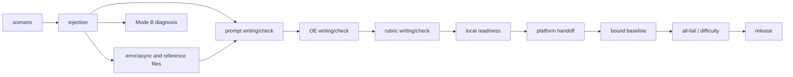

# Stage readiness and evidence

These authoring controls implement the reviewed 2026-11-08 plan. They do not
change evaluator policy, run SQL, deploy an environment or launch a baseline.
Historical task artifacts remain readable and are never migrated automatically.

## Task and stage identity

Always select the task explicitly (`--task-dir DIR`, or the positional task on
`stage_gate.py`). An omitted selection is accepted only in an unambiguous
single-task workspace. Artifact paths from another task are rejected. Contexts
and caches include the resolved task directory identity; moving a task requires
fresh attestations, not changing its historical evidence.

New V3 authoring uses `Working_Files/00_Readiness_Config.json`:

```json
{"schema_version": 1, "revision": "r1", "injection": "required"}
```

Revision is an explicit label, never inferred from a filename. `not_used` plus
`no_injection_reason` represents an explicit no-injection choice where the
applicable workflow permits one. This does not exempt this authoring engine's
existing injection/horizon requirements. The platform receipt validator supports
no-injection without fake SQL. Unknown deployment state stays unknown.

Stage gates require their current upstream attestations. Run the existing gate
with `--paste` (also writes an attestation) or `--attest` after the review. A full
PASS is required; `--rerun lint` remains PARTIAL. Records are immutable,
content-addressed files under `Working_Files/stage_evidence/`. A locked, atomic
index selects the current record; a replacement records `supersedes`.
Historical pasted certificates alone cannot certify new V3 work.
Generic `stage_evidence.py --record` imports cannot set gate producer metadata.
Readiness requires the full gate's execution record and all required artifacts,
not just an imported review marked PASS. This is execution provenance, not a
cryptographic defense against someone editing local files directly.

The dependency graph follows stage ownership:



Scenario does not depend on SQL, prompt, rubric or platform receipts. Rubric
planning checks provisional coverage, not the final rubric. Baseline updates do
not stale scenario/injection records. SQL edits stale dependent checks. Generated
gate text is excluded using the existing normalized digest. Readiness summaries
are derived and never become upstream inputs. Review support files are hash
checked again when freshness is assessed.

## Difficulty review

Save separate task-local reviews in
`Working_Files/hardness_reviews/{scenario,injection,prompt,rubric,baseline}.json`.
`design_readiness.input_hashes()` computes the precise stage projection. Each
review names schema version 1, stage, task identity, revision, reviewer, hashes,
selected diversity channels and per-mechanism evidence. See the executable
schema examples in `tools/test_design_readiness.py` and the specialist report
`Audit_2026-11-08_Hardness_Guide/Design_Implementation.md`.

Evidence references name a task-relative file and its SHA-256 plus a substantive
reason. Review believable initial answers, deciding evidence, authority and
chronology, persona discovery, changed outcomes, independent operation, and
natural search/list results. Semantic interpretation remains the reviewer's
responsibility. A generic “reviewed” waiver does not satisfy a finding. Concrete
inaccessible dependencies cannot be waived. Design materialization may be
deferred to injection; injection must resolve it.

Selected diversity channels need two existing, nonduplicate, independently
passable outcomes with both counterexamples. Outcomes must trace to requested
work. Work-kind weights, direct write coverage, sampling and atomicity safeguards
remain in force. Do not add explanations, duplicate facts or inflate weights.
Forecast probabilities stay advisory and uncalibrated. Before platform handoff,
save the actual rubric builder export at `Working_Files/09_Builder_Export.json`;
it must equal the reviewed rubric in the baseline review.

## Local and platform readiness

```sh
python3 Task_Authoring/tools/stage_gate.py --readiness local --task-dir DIR
python3 Task_Authoring/tools/stage_gate.py --readiness platform --task-dir DIR
```

The local command checks current local stage records without platform access or
baseline artifacts. The platform command additionally consumes
`Working_Files/Platform_Handoff.json`. A reviewer may normalize any actual vendor
evidence into this local schema; no vendor-specific receipt is required.

The receipt records task/revision, base universe, bundle identity, environment
and environment-state identities, applied SQL SHA-256 or explicit no-injection,
fresh-base deployment evidence, application evidence, decisive-record readability
and tool assumptions, and disclosed manual changes. Each proof is hash-bound to
the same environment state. Manual changes must be reconciled into the final
SQL. Before runs, `baseline_run_ids: []` is allowed; final release requires exact
association with actual bound export run/session IDs (or `sha256:<export hash>`
when the format lacks a single reliable ID).

Use `trajectory_ledger.binding_bundle_hash(DIR, rubric_path)` for bundle identity.
For a precheck use `binding_bundle_hash(DIR, stage='precheck')`; future OE/rubric
artifacts do not belong to that stage's bundle. Text hashes exclude generated
gate certificates, and reference-directory hashes include relative paths.
`readiness_controls.policy_identity(stage_gate)` provides the local policy/release
identity. Missing or different platform release identity is surfaced for review;
hash ordering never establishes authority. Evidence-backed compatibility review
preserves both identities and the historical verdict.
Compatibility `evidence_refs` must identify real task-local files with SHA-256
and an interpretation reason; their bytes are rechecked when consumed.

## Verifier binding and corrections

```sh
python3 Task_Authoring/tools/difficulty_stats.py --build --task-dir DIR \
  --verifier DIR/10_Baseline_Verifier_Results.md --rubrics DIR/09_Rubrics.json \
  --trajectories DIR/07_Baseline_Trajectories --revision r1 \
  --binding-receipt DIR/Working_Files/Verifier_Export_Binding.json \
  --out DIR/Working_Files/12_difficulty_input.json
```

Inline platform metadata can replace the receipt. Text-only exports need a
reviewed `VERIFIER_EXPORT_BINDING` receipt with task/revision/bundle/verifier
hashes, each numbered verifier slot's exact export hash or reliable run ID,
discriminating run-scoped observed content, and hash-checked supporting evidence.
Filenames never bind V3 grades. Not every verifier-observed end-state ID must
appear in the trajectory. Changed exports or superseded batches reject.

Scoring a saved V3 matrix rebuilds and compares its raw results against current
bound sources. It preserves the raw matrix and separate justified corrections.
Correction evidence is keyed `invalid:R1` or `run-1:R1` in
`Working_Files/Correction_Evidence.json` or embedded `correction_evidence`.
Errored runs remain errors, not zero scores. `--legacy-v2` is archival diagnosis
and marks filename associations `HISTORICAL_UNVERIFIED`.

## Mode B and repair ownership

Save `Working_Files/mode_b_request.json`; generate the structured report with:

```sh
python3 Task_Authoring/tools/mode_b_report.py --task-dir DIR \
  --request DIR/Working_Files/mode_b_request.json \
  --out DIR/Working_Files/Mode_B_Diagnosis.json
```

The hardening gate recomputes it from bound inputs. It includes the weight-5
raw/corrected matrix, exact failure sets and original transitive groups, causal
diagnoses citing actual zero-based trajectory events, and repairs with placement,
scope difference, discovery path, owner and bounded reruns. All-fail safety
checks and heavy-all-pass diagnosis derive from results, not author labels.
Corrections require evidence. Single prechecks are explicitly provisional and
can use reviewed surface grades without a final rubric or verifier.

Mode B proposes; scenario revision decides; injection implements universe changes;
prompt/OE/rubric stages own their artifacts. Routine volume alone is not a
difficulty repair; legitimate missing-data or fairness repairs remain allowed.
Production Mode B consumption also rechecks the matrix's weights, titles and
assignment against current sources. Paired outcomes must retain independently
covering final criteria. Repairs name known affected outcomes, a structured scope
difference and an explicit bounded list of stages to rerun. Changes to request
files, source matrices, receipts or cited proofs invalidate the current review.

## Parallel writes and measurement

The shared ledger locks reload, validation, conflict detection and commit as one
transaction. Duplicate identities are idempotent, conflicts reject, corrections
supersede. Entity publication has a per-target lock and unique atomic temporary
file. Task outputs and caches are isolated. Full KB maintenance and direct
evaluator-store writes are separate serialized maintenance/intake operations;
authoring does not mutate evaluator stores.
The forensic tools validate both explicit and default-discovered paths, including
`LABEL=PATH` arguments and symlinks. A selected task cannot read another task's
artifacts or write reports into another task; explicit ownerless archival
diagnostics remain available.

For authorized pilots record task/mode/revision, baseline reruns, late fairness
and coverage defects, wrong-evidence incidents, environment failures, false
blocks, review minutes and total authoring minutes. Compare similar tasks and
retain unknown values. No empirical reduction in reruns or total time has been
established by local regression tests.
