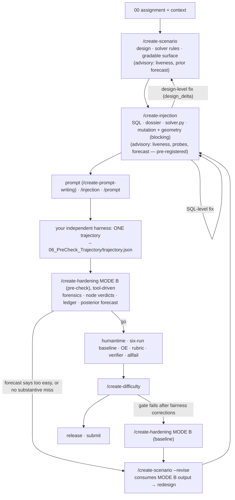

# Plan — fold `/create-hardening` into `/create-scenario` and `/create-injection`

> **Status:** proposal, revision 4; nothing implemented. 2026-10-24.
>
> **Revision 4:** run order, Opus 4.8 vs Opus 5.5, and gates by spec version (§15). Season Pass is a V2 task run on
> Opus 4.8; the CBs' V3 tasks run on Opus 5.5.
>
> **Your decisions (applied in revision 3):**
> 1. Blind model probes are approved as an authoring aid.
> 2. The empirical screen is yours: after scenario, injection and prompt exist, you run **one trajectory on an
>    independent harness** and place it in `06_PreCheck_Trajectory/trajectory.json`.
> 3. `/create-hardening` is **kept**. It stays the single owner of run forensics (MODE B), now tool-driven. MODE A moves
>    into scenario and injection. The removal checklist (§9) is deferred.
>
> **Scope:** `Task_Authoring/` skills, playbooks, tools and gates. The active Season Pass workspace (`task_inputs/`) is read
> as evidence only and is never modified by this plan.
>
> **Evidence labels:** **[O]** observed in a file or computed from one · **[D]** derived from observed numbers under stated
> assumptions · **[I]** inference or hypothesis to test.
>
> Revision 2 incorporates an independent adversarial review, revision 3 your decisions, and revision 4 the run order and
> model reconciliation. All are listed in §16. The theoretical improvement estimate is in §14.

## 0. The answer in brief

1. **What changes, and what can't.** MODE A's design audit moves into scenario and injection, so first-pass designs are
   checked before any run. `/create-hardening` stays (your decision) as the tool-driven owner of run forensics, and the
   six-run baseline is gated on a forecast from your single pre-check trajectory. Learning from real runs can't be
   removed, but it should be needed about once per revision rather than repeatedly.
2. **The evidence.** Of 13 designed nodes in this task:

   | Verdict | Nodes |
   |---|---|
   | FALSE | 8 |
   | LEAKED 6/6 | 2 |
   | LANDED, each in 1 of 6 runs | 2 |

   The raw average was 84.69 % and the clean average 93.36 %, against a Hard cap of < 70 %. **[O]**
3. **Three upstream causes.**
   - The gate counts traps but never checks that they can fire.
   - The links added for fairness (UGT, incorporation) neutralise the traps.
   - The rubric's weight geometry caps difficulty. 44.7 % of the weight passed in all six runs, and a design that only
     meets the ≥ 30 % mechanism-weight floor cannot pass Hard even if every mechanism lands. **[O]/[D]**
4. **The measuring tools already exist** as one-off scripts from revisions 11–12: a solver with rule ablation, coverage
   stress (mutation testing against rubric slots), causal interventions and a pre-check probe. Generalise them into
   bundle tools owned by scenario and injection.
5. **Sound checks block from day one; predictions start advisory.** Blocking from day one:
   - solver contract and regression;
   - a written disposition for every mutation result;
   - geometry impossibility, a provable upper bound (§5): no combination of the designed mechanisms can reach the cap;
   - a disposition for every revision-intake verdict;
   - no silent red-team skip.

   Probe results and the forecast probability start **advisory (UNCALIBRATED)**. They are pre-registered before each
   platform run, and become blocking only after prospective calibration (§10).
6. **The main empirical screen is your independent-harness trajectory** (§7.9). It is a real end-to-end run, so it is a
   stronger signal than an evidence-pack probe. Blind API probes stay optional, for cheap checks before a prompt exists,
   and are a conditional diagnostic, never a bound on platform behaviour.
7. **MODE B's work gets owners:**
   - forensic evidence comes from tools, run by `/create-hardening` MODE B (kept);
   - design decisions go to `/create-scenario --revise`, which consumes the MODE B output rather than re-deriving it;
   - verifier sanity goes to `/create-allfail` and `/create-rubric-writing check`;
   - OE defects go to OE check;
   - the numbers stay with `difficulty_stats.py`.
8. **REA supplies patterns, not a hardening engine** (§3).
9. **For revision 13 now:** under the rev-12 stress table, crossing 70 % needs each of the three new rules missed in
   roughly two thirds of runs (with the 24 proposed case slots) or about three quarters (existing slots). Under 65 % is
   impossible with existing slots (§13). Model T39 and run a probe before the next platform cycle.
10. **How much better, in theory (§14).**
    - Under explicit planning assumptions, expected six-run baselines per accepted task fall from about 2.9 to 1.9 with
      better screening alone, or to 1.3 with better design too. Expected revisions fall from about 4.3 to 1.6. **[D]**
    - The certain part is structural: under their stress model, the rev-12 mechanisms cannot pass all V3 Hard gates
      jointly. The SD floor and the pattern gate fail even where the mean would pass. Under V2's gates the best case is
      about 11 % (§15.5).
    - The evidence base is five examples. The measured range still includes no improvement until the next tasks are
      tracked.
11. **Run order and models (§15).**
    - Run revision 13 now, under a frozen pre-registration (`plans/Rev13_Preregistration.md`). Add a harness-calibration
      arm on revision 10 and an Opus 5.5 bridge arm.
    - Implement Phase 0 in parallel.
    - Opus 4.8 runs can reject a design for V3 but never accept one.
    - Gates follow the task's spec version: V2 < 75 %; V3 Hard < 70 %.

## 1. Diagnosis — why the skills produce tasks Opus clears

### 1.1 The design gate counts structure, not liveness
- The extreme profile requires ≥ 12 traps in ≥ 7 families, ≥ 6 distractors, ≥ 4 supersessions and ≥ 2 authorities
  (`tools/hardness_gate.py:69-88`, `references/Hardness_Manifest_Spec.md:76-96`). The gate proves the declared records
  exist in the SQL; it cannot show a trap fires. **[O]**
- Baseline outcome (`Working_Files/01a_Hardening_Report.md:55-69`): **[O]**

  | Verdict | Nodes |
  |---|---|
  | FALSE ×8 | T1, T3, T5, T7, T8, T11, T12, T13 |
  | LEAKED 6/6 ×2 | T10, T15–17 |
  | CONFOUNDED ×1 | T20 |
  | LANDED ×2 | T4/T14 in run-1; T18/T19 in run-6 |
- The library already predicts this: "Retrieval traps, decoys and authorities that every run reached leaked"
  (`references/Hardness_Mastery.md:98`). The gate still rewards building them.

### 1.2 Fairness rails neutralise the traps
Most FALSE verdicts are side effects of fairness work (`01a_Hardening_Report.md:57-66`): **[O]**

| Node | Neutralised by |
|---|---|
| T8 | the hub links the exact current deck |
| T13 | the exact folder is linked at entry |
| T11 | the exact tracker is named |
| T5 | two explicit scope predicates remove the wrong-game row |
| T7 | the decoy body names the other game immediately |
| T3 | the guide defines WATCH up front |
| T12 | the audit asks for all checks |

Nothing in scenario S4/S8 (incorporation, UGT links) checks how they interact with S5 (traps). **[O]**

The fix is never to remove those links. It is to put the difficulty in the judgment that remains after the correct
target is found.

### 1.3 Opus solves by complete retrieval, then fan-out
Computed from `Working_Files/hardening_rev11/*.calls.json` (7 exports): **[O]**
- 3,891 MCP calls over 54 distinct tools.
- Five per-record reads make up 93.6 % of the calls:

  | Tool | Calls |
  |---|---|
  | `linear_list_comments` | 911 |
  | `github_get_pull_request_timeline` | 911 |
  | `github_get_pull_request_reviews` | 781 |
  | `github_get_issue_comments` | 781 |
  | `github_pull_request_read` | 259 |
- 62 subagent (`Agent`) calls, about 9 per run.

Subagent briefs that mention the issue remap (regex `control tab|control sheet|replacement issue|ZOM-80[2-5]`): **[O]**

| Run | Briefs mentioning the remap |
|---|---|
| run-1 | 3/10 |
| run-2 | 4/12 |
| run-3 | 4/8 |
| run-4 | 5/8 |
| run-5 | 4/8 |
| **run-6** | **0/8** |

Run-6 is the only run that used the original issues (T18/T19 LANDED). This is one observation, consistent with
"difficulty lands when a rule does not reach the workers". **[I]**

The property that matters is therefore "survives complete retrieval" (`playbooks/01a_Hardening.md:94`). Today it is
checked only in the optional MODE A.

### 1.4 The rubric geometry caps difficulty before any run
- Expected corrected average = 1 − Σᵢ (wᵢ / W) · P(row i fails). An average strictly below 70 % needs a weighted
  row-failure rate above 0.30, plus margin for six-run noise. **[D]**
- 34 of 59 rows (88 of 197 weight, 44.7 %) passed in all six runs (`Working_Files/12_difficulty_input.json`). **[O]**
- The MODE A floor is "mechanism-dependent criteria carry ≥ 30 % of planned weight" (`01a_Hardening.md:96`). A design
  that only meets it cannot pass Hard: even if all those rows failed in every run, the average would be exactly 70 %, and
  equality fails. The floor is too low for Hard. **[D]**
- Errors cancel in aggregates. A solver ignoring three rev-11 policies produced 41 wrong rows and 77 wrong fields, yet
  still matched HOLD 54 and the review-group count (`hardening_rev11/confidence_audit.md:9`). **[O]**
- Interactions are non-monotone: **[O]**
  - Rev 11: ignoring three policies projected 83.55 %, higher than ignoring two at 73.68 %
    (`hardening_rev11/coverage_stress.txt:5,8`).
  - Rev 12: journal + acceptance projects 65.99 %, below all three at 68.03 % (`hardening_rev12/coverage_plan.json`).
  - Any forecast must therefore enumerate exact solver combinations; an independence formula is not enough.
- The rubric is written after the baseline starts (`Guide/How_To_Author_A_Task.md:48-60`). Nothing at scenario time
  gates what the deliverables make gradable. **[O]**

### 1.5 The decisive measurements exist, but after the fact and only for this task
| Script | What it already does |
|---|---|
| `Working_Files/hardening_analysis.py` (`solve(sql, new, disable)`) + `hardening_rev12/oracle.py` | Deterministic reference solver over the parsed SQL, with per-rule `disable=` ablation |
| `hardening_rev11/coverage_stress.py`, `hardening_rev12/coverage.py` | Mutation testing: which rubric slots each ablation flips, with a weighted projection |
| `hardening_rev12/verify.py` → `verification.json` | Causal interventions; `setup/GEN_EXECUTION.md:484-486` still lists this as an open gap |
| `hardening_rev11/precheck_probe.py` | Decodes CSV/Sheets writes, compares them with the solver, checks model labels, detects seeded ids in results |
| `Working_Files/hardening_intake.py` | Turns a trajectory into calls, narration and writes ledgers |

All of them hard-code SP-001…128, `match3d#544+n`, the remap table and the snapshot (`hardening_analysis.py:7-22`). **[O]**

### 1.6 Independent review never ran
`01b_Redteam_Review.md:5` reads `redteam_review: set REDTEAM_MODEL or pass --model`. When that happens the scenario gate
warns instead of blocking (`playbooks/01_Scenario_Design.md:330-332`). **[O]**

### 1.7 What the loop costs now
- Hardening revisions 11–13.
- Platform reviews in `Plateform_reports/`: 2 hardness, 5 injection, 4 rubric and 3 prompt.
- One platform run cost $40.27 (`Plateform_reports/02_hardness.md` §1), so a six-run baseline is about $240 per
  cycle. **[O]/[D]**

## 2. `/create-hardening` decomposed: every part and its new owner

> **Revision 3 (decision 3):** `/create-hardening` is kept as the single owner of run forensics. The forensic steps in
> this table (B0–B4) stay in `/create-hardening` MODE B and run on the tools listed here. Where this table names
> "scenario S0r" for B0–B4, read "`/create-hardening` MODE B". S0r only **consumes** that output to make design
> decisions (B5–B6). MODE A (A1–A6) moves into scenario and injection as shown.

| Part | What it does | New owner | Made mechanical by |
|---|---|---|---|
| A1 Register the design | node · mechanism · records · wrong reading · overturning evidence · discovery order | `/create-scenario` S5 (manifest `traps`/`chains` + new `mechanism_portfolio`) | `hardness_gate.py` field checks |
| A2 Explore coupling seams | under-used couplings | `/create-scenario` S1 | — |
| A3 Ranked grounded candidates | 10–15 cited candidates | `/create-scenario` S5a | ledger priors per candidate |
| A4 Depth over breadth | prefer A1/A15/A16/A17/A19; reject lookups, bolt-ons | `/create-scenario` S5a | advisory forecast ranking |
| A5 Adversarial lazy solver | fewest calls, first hits | `/create-injection` S5b | information-ablation mutants |
| A5b(1) Incorporated | anchor → rule chain | scenario S4 (exists) | `hardness_gate` incorporation checks (exist) |
| A5b(2) Survives complete retrieval | the step still hard with everything open | declared in scenario S5a; diagnosed in injection S5d | `judgment_probe.py` (advisory) |
| A5b(3) Tool-surface proof | the deciding record is returned by the natural call | injection S5c | `trap_liveness.py` flags + recorded platform calls |
| A5b(4) Graded weight | mechanism share of the weight | scenario S6b + injection S5e | `01_Gradable_Surface.json`, geometry check, forecast |
| A6 Implement | SQL via injection S1–S5 | `/create-injection` (unchanged) | existing gates |
| B0 Run validity | model labels incl. subagents, compaction, events after the final result, missing or duplicate files | shared tool → `/create-difficulty` | `trajectory_ledger.py` (+ `difficulty_stats.model_gate`) |
| B0 Hint and source match | export matches the revision's content; no hint | scenario S0r | `trajectory_ledger.py` content match against the revision's seeded ids |
| B0 Re-applied injection | seeded records appear in results | scenario S0r | `trajectory_ledger.py` |
| B0 File ↔ verifier-run mapping | by content, never by file order | `/create-difficulty` | `trajectory_ledger.py` + `difficulty_stats.build` |
| B1 Full read incl. write payloads | every call, input and result | shared tool + model review | `trajectory_ledger.py` decodes every call. The model reviews every call that touches a node's deciding records, briefs or writes, plus any call the tool cannot classify. Unreviewed calls are listed, and each verdict states its coverage |
| B2 Friction and horizon | async, forced errors, tool defects, call count | `/create-difficulty` (+ `/create-error-async`) | `trajectory_ledger.py`, `difficulty_stats.count_tool_calls` |
| B3 Node verdicts | LANDED … CONFOUNDED | `/create-scenario --revise` (S0r) | `node_verdicts.py` proposes; the model dispositions |
| B3b Score shape → fix | bimodal, uniform success … | `playbooks/12_Difficulty.md` (merge into its table at :94-98) | — |
| B3c `/hardness` band prediction | requirement map | platform `/hardness` (unchanged) | — |
| B3d Clean average and mechanism share | corrected view | `/create-difficulty` | `difficulty_stats.py` corrected view |
| B3e Verifier sanity | judge text vs trajectory | `/create-allfail`, `/create-rubric-writing check` | decoded write payloads |
| B4 Why Opus passed | classify every pass | scenario S0r | `node_verdicts.py` + ledger |
| B5 Purge false difficulty | drop BYPASSED and FALSE nodes | scenario S0r → `design_delta` | mutation and liveness diagnostics |
| B6 Route fixes | universe → injection; prompt → prompt check; OE → OE check; criteria → rubric check / allfail | scenario S0r | — |
| Gate 4 "do not tune to the baseline" | — | `GEN_EXECUTION.md` (global rule) | §11 guardrails |
| Gate 7 "every SQL change re-passes 01" | — | `/create-injection` (it *is* the revision) | injection gate + `design_delta` (exist) |
| `revision.injection` in `st_hardening` | re-run injection checks on revision N+1 | removed; injection re-runs itself | — |

## 3. What REA contributes, and what it doesn't

| REA pattern | Where in REA | Use here |
|---|---|---|
| Fix the producer before adding downstream repairs; remove superseded wrappers after consumers migrate | `AGENTS.md:27` | The organising principle: scenario and injection own difficulty; the repair stage is deleted after its consumers move |
| One owner per interpretation | `AGENTS.md:19` | The solver owns truth, `trajectory_ledger.py` owns run facts, and `difficulty_stats.py` owns gate math (the forecast calls it, never re-implements it) |
| Idempotent, conflict-rejecting evidence ledger | `src/application/investigation/EvidenceLedger.ts:71-74` | `hardness_ledger`: immutable records; corrections supersede, never overwrite |
| Unknowns that carry the probe that would settle them | `src/domain/residualUnknown.ts:14,40,114-115` | An unmeasured mechanism is an unknown with its probe attached |
| An unknown blocks only the claims that depend on it | `docs/reconstruction-coverage.md:70-80` | The unknown limits only forecasts that rely on that mechanism |
| Known-answer scoring: an expected value plus the producer facts that must support it | `tests/evaluation/model-evals/KnownAnswerEvaluation.ts:17-40` | Forensic scoring checks the value against the evidence the responsible agent actually saw |
| Real-agent evaluation with disposable HOME and CODEX_HOME, sequential runs, owned cleanup, no copied user configuration | `docs/client-verification.md:452-498` | Isolation requirements for any agent-based probe (§7.4) |
| Environment state derived from captures; a per-tool render plan kept only where it reproduces recordings | `docs/agent-environments.md:245-262` | The fidelity rule for any future local simulation (§7.8) |
| Fidelity measured on calls the capture did not make | `docs/agent-environments.md:753-760` | Same |
| Mutation testing (killed / survived) | `package.json:168`, `stryker.config.mjs` | Difficulty mutants, used as diagnostics (§7.2) |
| Simulated providers do not establish real-provider behavior; controlled probes do not replace real lanes | `AGENTS.md:83`, `docs/testing.md:506-508` | Probe results are labelled and calibrated before they count |
| Measure representative completed tasks before and after | `AGENTS.md:56` | §10 metrics |

What REA does **not** provide:
- No hardening or task-difficulty pipeline, no six-rollout protocol, no trajectory forensics.
- Its environment server matches web (HTTP) captures, not MCP tool calls.
- Its own skill says to skip REA for source-repository analysis (`.agents/skills/reverse-engineer-anything/SKILL.md:3`).
  We borrow its method (inspect → explain with evidence → rebuild → verify the reconstruction), not its runtime.

## 4. Target design

### 4.1 Flow

If the platform still requires its own Opus pre-check for `/hardness`, keep it. Your independent-harness run is then
the earlier, cheaper screen. Its source is recorded as `independent-harness` in the ledger, so it is never conflated
with platform evidence.

### 4.2 Blocking now vs advisory until calibrated
| Check | Stage | Status | Why |
|---|---|---|---|
| Solver contract: deterministic; reproduces the previous revision's truth on the previous SQL; rules ↔ manifest nodes; every slot produced | injection | **blocking** | Procedural soundness; already done by hand in revision 12 |
| Every mutation result has a written disposition | injection | **blocking** | Forces each EQUIVALENT / SURVIVED / WEAK node to be confronted, without auto-labelling it FALSE |
| Geometry impossibility: the flippable-weight upper bound U ≤ 1 − cap (§5) | injection | **blocking** | A proof: no supported failure state of the designed mechanisms can reach the cap |
| Geometry margin: largest loss over whole-mechanism combinations < (1 − cap) + 0.10 | injection | advisory | The margin is a judgment, not a proof |
| Every revision-intake verdict dispositioned; exports bound to their revision | `/create-hardening` MODE B (verdicts); scenario `--revise` (dispositions) | **blocking** | Evidence handling |
| Red team ran, or an explicit fallback is recorded | scenario | **blocking** | Removes the silent skip |
| Liveness flags (breadcrumb, self-advertising decoy, order, placement) | scenario, injection | advisory, but each flag needs a written disposition | Lexical heuristics; local search is not platform ranking |
| Pre-check intake of your independent-harness trajectory: node verdicts + posterior forecast (§7.9) | `/create-hardening` MODE B (pre-check) | advisory (UNCALIBRATED), **pre-registered**; it decides whether to spend the six-run baseline | One run is strong evidence against a design and weak evidence for one (§7.9) |
| Optional blind API probe results | injection | advisory (UNCALIBRATED) | Conditional diagnostics |
| Forecast P(all gates pass), E[average] | scenario, injection | advisory (UNCALIBRATED), **pre-registered** | Joint model not yet calibrated |

### 4.3 New artifacts
| Artifact | Producer | Content | Consumers |
|---|---|---|---|
| `Working_Files/solver/solver.py` → `solver/truth.json` | rules: scenario; record access: injection | rule ids = manifest node ids, each with a natural-reading fallback; evidence index per output field | mutation, probes, forecast, dossier facts, OE/rubric expected values |
| `Working_Files/01_Gradable_Surface.json` | slots: scenario; expected values + `flipped_by`: injection | fact slots with stable global fact ids, work-kind weight (1/3/5), class, mechanisms, incorporating span | geometry check, forecast, `/create-rubric-writing` coverage seed |
| `Working_Files/01c_Preflight_Report.md` (+ `.json`) | injection | solver checks, mutation dispositions, geometry, liveness, probes, forecast, pre-registration hash | injection gate, revision intake, calibration |
| `support/hardness_ledger/ledger.jsonl` → generated `references/mechanism_priors.json` | tools | cross-task verdicts, probe results, pre-registered forecasts | scenario S5a, forecast, calibration |
| `Working_Files/run_forensics/<revision>/<run>/` | `trajectory_ledger.py`, `node_verdicts.py` | calls, decoded writes, subagent briefs and results, node verdicts, revision binding | `/create-scenario --revise` |

### 4.4 `/create-scenario` changes
Keep S0–S4, S7, S8 and the red team. Change or add:
- **S0r Revision intake.** Runs when a `/create-hardening` MODE B report exists for the current revision. Steps 1–2 are
  performed by MODE B (kept, decision 3); S0r consumes their output and owns steps 3–5.
  1. *(MODE B)* **Bind each export to the revision it ran on** (content match against that revision's seeded ids and
     values). Evaluate it with **that revision's** solver. Historical evidence never certifies a new revision, and an
     old export never blocks a repair.
  2. *(MODE B)* Run `trajectory_ledger.py` and `node_verdicts.py`, then append the results to the ledger. The model
     reviews every call that touches a node's deciding records, briefs or writes, plus every call the tool cannot
     classify. Unreviewed calls are listed, and each verdict states its coverage.
  3. Disposition every proposed verdict: keep, purge or rebuild. Confirm or assign CONFOUNDED (tool, fairness, verifier,
     run).
  4. Route each finding to its owner:

     | Finding | Goes to |
     |---|---|
     | verifier defects | `/create-allfail` and `/create-rubric-writing check` |
     | OE defects | `/create-oe-writing check` |
     | prompt-side defects | `/create-prompt-writing check` |
     | universe-side changes | S5a onward |

  5. Write it all to `01_Scenario_Design.md` §14.
- **S1 coupling seams.** MODE A A2 joins the storyline step.
- **S5a Mechanism portfolio.** This becomes the design driver; the trap counts stay as floors.
  - Generate 10–15 grounded candidates. Each carries:
    - its ledger prior (with record ids);
    - the step that stays hard after complete retrieval;
    - the natural call that returns the deciding record;
    - its incorporation chain;
    - the gradable slots it affects.
  - Select by expected loss and independence.
  - Never resolve a liveness flag by removing an incorporation or UGT link.
- **S5b Design liveness flags** (`trap_liveness.py --design`, §7.3): advisory; each flag gets a written disposition.
- **S6b Gradable surface.** Write `01_Gradable_Surface.json` and validate it against the V3 rubric rules:
  - work-kind weights;
  - ≤ 5 samples per group, plus a volume row;
  - direct exception slots only for members an incorporated authority singles out;
  - no fact in ≥ 3 slots.
- **Solver rules.** A `solver/solver.py` skeleton with one rule per mechanism node. Each rule has an explicit
  natural-reading fallback.
- **S9b Prior forecast** (advisory, pre-registered): `hardness_forecast.py --design`.
- **Red team.** Make `REDTEAM_*` a precondition, or record an explicit fallback; no silent "unavailable".

### 4.5 `/create-injection` changes
Keep S1–S5 and every existing check. Add:
- **S4b Solver completion** (blocking). `solver.py` meets the `oracle_kit` contract. `truth.json`, and every total in the
  dossier and in Facts for the human, comes from the solver (`Hardness_Mastery.md` §2.6 item 14). Golden values are
  spot-checked against the source records through `tools/hg.py`.
- **S5b Mutation and interventions** (`difficulty_mutation.py`, §7.2). Every result needs a written disposition
  (blocking).
- **S5b′ Geometry.** Impossibility blocks; the margin is advisory (§5).
- **S5c Liveness flags** on the SQL (advisory, dispositioned).
- **S5d Blind probes** (advisory, §7.4).
- **S5e Forecast** (advisory). Pre-registered: its hash is stored in the ledger before the platform run.
- **Loop.** An SQL-level fix stays here. A design-level fix returns to `/create-scenario` with a `design_delta`.
  Revision N+1 is this stage run again.

### 4.6 Consumer changes outside the two skills
- **`/create-rubric-writing`** seeds its coverage plan from `01_Gradable_Surface.json`.
  - New check `surface.coverage`: every surface slot an incorporated requirement makes gradable is covered, or
    dispositioned with a reason. This follows the existing `missing_coverage` rule.
  - The mechanism share is **reported, not gated**, so authors are not pushed to select criteria for forecast loss.
  - Weights stay by kind of work. Spot checks follow the existing rule: "hard and edge cases plus one ordinary"
    (`playbooks/09_Rubric_Writing.md:70`).
- **`/create-difficulty`** owns B0 file mapping, B2, the B3b routing and the corrected numbers. On a failure its next
  step is `/create-scenario --revise`.
- **`/create-allfail`** and **`/create-rubric-writing check`** own B3e verifier sanity.
- **`/create-oe-writing check`** receives OE defects found in revision intake.
- **`/create-prompt-writing`** reads prompt constraints from the dossier only (the `01a` input is dropped).

## 5. The hardness budget — forecast and geometry
- **Target: corrected semantic results**, the gate of record (`GEN_EXECUTION.md:151,169-183`). Verifier false-passes
  are not modelled into the target. They are a separate risk, caught by B3e and corrected before the difficulty gate.
- **Observational unit** (matching §1.3). Within one run, each mechanism m can fail in two ways:
  - **Shard miss:** the rule fails to reach a worker batch. Every affected record in that shard is then wrong. Actual
    batch sizes are derived from the recorded subagent briefs; 128 / 9 ≈ 14 records is only the average here.
  - **Record slip:** an independent error on a single affected record.

  The solver supports `disable={(rule, key_subset)}`, so per-shard misses are computed exactly.
- **Dependence model.**
  - A shared per-run latent for mechanisms whose rules come from the same source.
  - Several dependence **scenarios** are always reported: independent, fully correlated, and a range of shard sizes.
    Because outcomes are non-monotone, these are scenarios, not bounds.
- **Exact combinations.** flipped(F) comes from the solver for every combination of failing mechanisms, all 2ᵏ for
  k ≤ 8. Beyond eight mechanisms the forecast reports `UNSUPPORTED` rather than approximating. Interactions are
  non-monotone (§1.4).
- **Simulation**, 10,000 draws:
  1. Draw each mechanism's parameters from its posterior.
  2. Draw six runs.
  3. Build the corrected rubric × rollout matrix.
  4. Call `difficulty_stats.compute()` with the V3 view and the assigned mode from `00_Task_Context.json`. `tool_calls`
     comes from the call budget; horizon is gated separately.
- **Report.**
  - E[average] and its 10–90 % band.
  - P(average < cap), P(≥ 5 full passes), P(SD in 0.1–0.3), P(≥ 2 patterns with the largest ≤ 50 %).
  - P(all gates pass).
  - Value of information: the mechanisms whose uncertainty moves the result most. These are the **budget-critical**
    mechanisms; probe them first.
- **Geometry.**
  - **Upper bound U (blocking).** A slot counts as *flippable* if any supported error state of the designed mechanisms
    changes it. The error states are:
    - for per-record slots, every combination of rule ablations applied to that record (2ᵏ, k ≤ 8);
    - for aggregate and write-content slots, any change in a record that feeds them;
    - every degrade operator.

    U is the weight share of all flippable slots. Any run's mechanism-driven loss is at most U, whatever the shard
    pattern, partial failures or cancellation.
  - The average must be strictly below the cap, which needs a loss strictly above 1 − cap. If U ≤ 1 − cap, no
    combination of the designed mechanisms can clear the cap: block, and redesign the deliverables. Delivery slots fail
    only at a base rate, which is not designed difficulty, so they are excluded.
  - **L_max (advisory).** The largest projected loss over whole-mechanism combinations. It is not a proof, because
    partial failures can disrupt cancellation. The warning fires when L_max < (1 − cap) + 0.10.
  - At scenario time, before the solver exists, both checks use declared attributions and are advisory only.
- **Calibration status.** The forecast prints `UNCALIBRATED` until §10 Phase 2 meets its adequacy criteria.
  - Each forecast is pre-registered: inputs and outputs are hashed into the ledger before the platform run, and
    compared afterwards.
  - Adequacy criteria are themselves pre-registered before any calibration data exists. Proposed:
    - the corrected average falls inside the forecast's 10–90 % band on every calibration task;
    - the Brier score of P(all gates pass) beats a constant base-rate predictor;
    - every mechanism family the threshold relies on has probe-vs-platform evidence.
  - Blocking thresholds are adopted only after those criteria are met. Starting candidates: injection P(all gates pass)
    ≥ 0.8 and E[average] ≤ cap − 0.05.

## 6. Designing for the Opus that actually runs here
Measured in `Hardness_Mastery.md` §0 and §11 and in this task.

**Stop counting on:**
- decoys and authorities every run reaches;
- explicit rules stated where the agent reads first;
- corrections placed in hub replies;
- forced errors and async waits;
- traps that collapse once fairness requires an exact link (keep the link; move the difficulty).

**Invest in** (measured transfer):
- A1: a wrong summary met first, plus a thread that continues past its apparent conclusion;
- A15: a house rule that overrides the natural reading, applied per record;
- A16: a conflict the prompt asks to be reported;
- findings on records whose state is already correct;
- A17: cohort membership not keyed by a keyword;
- A19: derived comparisons;
- partial resolution read from code.

**Anti-fan-out mechanisms.** These are hypotheses. Measure them before the forecast credits them above the family prior:
- *A22 cross-shard dependency:* a record's correct value depends on evidence attached to another cohort member.
- *A23 brief-transmission loss:* an exception rule homed outside the main instructions that applies to an unpredictable
  subset. This is the remap pattern: 1/6 here.

**Geometry rules:**
- several direct exception slots per mechanism, each weighted by its kind of work;
- write-content slots that carry mechanism outputs, rather than bare existence or destination slots;
- outputs that cannot cancel: per-record reasons and blocker groups, not only totals;
- slots the verifier can check from the final state (`Hardness_Mastery.md` §8);
- **a variance budget** (§14.3): 2–4 independent mechanisms, each carrying roughly 15–35 % of the weight and landing
  about half the time or more, with always-pass weight near 30 %. A low mean is not enough: the six-run SD must reach
  0.10, and failing runs must show at least two patterns.

**Seed observations for the ledger** (Opus 4.8). The ledger tool computes the priors; this table is not their source of
truth.

| Mechanism | Landed / runs | Source |
|---|---|---|
| A15 house rule per record | 4/6 | V7-T1 (`Hardness_Mastery.md:732`) |
| Finding on already-correct state (A6/A15) | 5/6 | V7-T1 (`:733`) |
| A16 conflict to report | 5/6 | V7-T1 (`:734`) |
| A17 boundary not keyed by a keyword | 3/6 | NF2 (`:728`) |
| A1 wrong summary + thread past its conclusion | pass@1 0/6 | ML-selected task (`:41`) |
| Decoys and authorities every run reached | 0/6 | this task T10 and T15–17; V7-T1 (`:736`) |
| A23 brief-transmission loss | 1/6 | this task T18/T19 |
| Row association at scale (an A2 slip) | 1/6 | this task T4/T14 |

## 7. Tool specifications
All new tools: stdlib Python like the existing ones, `--self-test`, read-only on their inputs, never execute SQL, accept
`--task-dir`, and write only inside `Task_Authoring/` (`GEN_EXECUTION.md:93-94`).

### 7.1 `tools/oracle_kit.py` + per-task `solver/solver.py`
- **Contract.**
  - `RULES: {node_id: {mechanism, requirement, natural_reading}}`
  - `solve(state, disable=frozenset(), degrade=frozenset()) -> {key: {field: value}}`, where `disable` takes rule ids or
    `(rule, key_subset)` pairs
  - `aggregates(rows)`
  - `evidence(key, field) -> [record ids]`
- **`load_state`.** Base records through `tools/hg.py` plus SQL rows through `base_check.parse_sql`, as
  `hardening_analysis.py` does today.
- **Degrade operators:**
  - `no_replies`
  - `no_service:<svc>`
  - `first_hit:<query>`
  - `trust:<record>`
  - `pre_amendment:<id>`
  - `no_pagination:<n>`
- **Blocking checks:**
  - output is deterministic;
  - it reproduces the previous revision's truth on the previous SQL;
  - rules and manifest nodes match one-to-one;
  - every gradable slot is produced by the solver;
  - golden values are spot-verified against source records.
- **Port first.** `hardening_analysis.py` + `hardening_rev12/oracle.py` become the first conforming solver.
- **Recurring cost.** Each new task needs its own solver rules. This is the price of measured difficulty; the Season Pass
  solver is about 200 lines.

### 7.2 `tools/difficulty_mutation.py` (diagnostics)
Generalises `coverage.py`, `coverage_stress.py` and `verify.py`.
- **Mutants:** every rule ablation, shard ablation and degrade, plus the exact combination table the forecast needs.
- **Diagnostics:**

  | Diagnostic | Meaning |
  |---|---|
  | KILLED | flips at least one direct slot of weight ≥ 3 |
  | WEAK | flips only aggregate or weight-1 slots, or the aggregate change cancels |
  | SURVIVED | changes outputs but no slot |
  | EQUIVALENT | changes no output |

  EQUIVALENT can mean a FALSE trap, but also a redundant rule, a masking interaction or an incomplete solver. It is
  never auto-labelled; the author dispositions it.
- **Interventions.** For each node, remove or alter its deciding records in the overlay. Changes must stay within the
  node's **declared dependency closure**: its own slots plus the aggregates and writes that depend on them. This closes
  `GEN_EXECUTION.md:484-486` without rejecting legitimate coupling.

### 7.3 `tools/trap_liveness.py` (advisory flags)
The entry set is the prompt anchors, the hub and its direct delegations. The tool flags:

| Flag | Condition |
|---|---|
| Breadcrumb collision | the entry set contains the resolver's decisive tokens |
| Self-advertising decoy | the scope token, or "draft / old / superseded", appears in the decoy's title or first lines |
| Order | the correction sits in the hub thread |
| Rule placement | an A15 rule is stated verbatim in the first-read source |

Limits and handling:
- These are lexical warnings, not proof. `persona_view.py search` has no SQL overlay (`tools/persona_view.py:787`) and
  does not reproduce platform ranking.
- Overlay search exists in `tools/shortcut_probe.py` (`--sql`) and can be reused.
- Ranking claims are validated only against recorded platform calls.
- Every flag needs a written disposition. The response is to redesign the difficulty, never to remove a fairness link.

### 7.4 `tools/judgment_probe.py` (optional; advisory, conditional diagnostic)
With decision 2, your independent-harness trajectory (§7.9) is the main empirical screen. This probe is optional. Use it
before a prompt exists, or to test one mechanism cheaply between revisions.
- **What it measures.** Whether a blind Opus-class agent, given complete evidence, applies each mechanism correctly. It
  does not bound platform behaviour in either direction:
  - It is easier than the platform: there are no hundreds of calls and the records are curated.
  - It can be harder: workers cannot fetch missing rules or repair a bad brief.
  - It changes prevalence: the sample is enriched for exceptions.
- **Variants.** Run both:
  - single-context;
  - fan-out: a blind lead reads the rule sources and writes worker briefs; blind workers receive only a brief and their
    batch.

  Record exactly which evidence each worker could see.
- **Sample and pack.**
  - Records where each mechanism flips the output, plus controls. Results are reweighted to population prevalence before
    they are used.
  - Raw records are rendered in platform tool-result shapes copied from recorded trajectories, in natural discovery
    order, with the decoys and distractors a correct run meets.
  - A scrub check fails the pack if it contains manifest ids, mechanism names or design vocabulary.
- **Runner, boundary-compliant by default.**
  - Reuse the HTTP client pattern of `tools/redteam_review.py`, with `PROBE_BASE_URL`, `PROBE_API_KEY` and `PROBE_MODEL`
    from the environment, never printed.
  - The pack is sent inline with no tools enabled.
  - Results are written under `Task_Authoring/support/probe_runs/`.
  - A `claude -p` runner is allowed only with an explicit write-boundary exception and REA-style isolation: disposable
    HOME and config, no user configuration copied, verified from the run's init event.
- **Scoring.** Compare against `truth.json` and the evidence each agent actually saw. Then run a fairness review: a
  defensible alternative reading is a UGT defect to fix in the wording, never hardness.
- **Output.** Per-mechanism results go into the ledger with `source: probe` and stay separate from platform evidence
  until a calibration factor exists for that mechanism family.

### 7.5 `tools/hardness_forecast.py` (advisory until calibrated)
Implements §5 and calls `difficulty_stats.compute()`. It writes pre-registration records into the ledger. `--design`
uses priors and declared attributions only.

### 7.6 `tools/hardness_ledger.py`
- **Record fields:**
  - `id` (`hev_<sha256-16>`), `kind`
  - `task`, `revision`, `sql_sha256`
  - `source`: `platform-precheck` · `platform-baseline` · `probe` · `forecast`
  - `model`, `run`, `node`, `mechanism`, `features`
  - `verdict`, `evidence`
  - `epistemic`: `observed` · `derived` · `inferred`
  - `supersedes`
- **Rules** (from REA's ledger):
  - records are idempotent by id, and a conflicting record with the same id is rejected;
  - corrections supersede earlier records;
  - NOT-REACHED or unread stays unknown;
  - model and source are always kept.
- **Seed:**
  - this task's revisions 10–13;
  - the §11 calibration tasks;
  - §0's measured numbers as weak priors with source tags.

### 7.7 `tools/trajectory_ledger.py` and `tools/node_verdicts.py`
**`trajectory_ledger.py`** generalises `hardening_intake.py` and the decoding half of `precheck_probe.py`. It covers:
- B0 validity;
- revision binding by content;
- the call ledger;
- decoded write payloads;
- subagent briefs and their results;
- call counts via `difficulty_stats.count_tool_calls`.

**`node_verdicts.py`** checks, per node × run:
- Was the deciding record in a result the responsible agent saw?
- Did the briefs for the affected records carry the rule?
- Does the written value match the solver for **that revision**?

It proposes LANDED, LEAKED, NOT-REACHED, BYPASSED or FALSE, with event citations. CONFOUNDED is only ever flagged as a
candidate, never assigned.

Both tools read probe and platform exports alike. The platform agent is Claude Code (`claude-opus-4-8[1m]`, Claude Code
2.1.280, MCP server `hg`; `Plateform_reports/02_hardness.md` §1).

### 7.8 Later, not in scope: a local tool-surface simulation
A local MCP over base data + overlay could serve the five keyed reads faithfully. Two things keep it out of scope:
- **Policy.** `GEN_EXECUTION.md:95-98` says a `/create-*` command never imitates Portal operation. Labels alone don't
  authorize it; it needs your explicit decision.
- **Fidelity.** Search ranking, which decides whether decoys are met, is the hard part. REA's rule would apply: keep a
  renderer only where it reproduces recorded results, and measure fidelity on held-out revisions.

### 7.9 Pre-check intake for your independent-harness trajectory (`/create-hardening` MODE B, pre-check)
**Trigger:** `06_PreCheck_Trajectory/trajectory.json` appears for the current revision, after scenario → injection →
prompt.

**Steps.** Each uses the shared tools above.
1. **Validity** (`trajectory_ledger.py`):
   - harness identity and model labels, including subagents, from the init event;
   - completeness: a final result event, no compaction gaps, no background events after the result;
   - **revision binding by content**: the current revision's seeded ids and values appear in the results;
   - prompt match by content, because exports may omit the user prompt.
2. **Node verdicts** (`node_verdicts.py`, against this revision's solver). For each node: LANDED, LEAKED, NOT-REACHED,
   BYPASSED or FALSE, with event citations. Also a per-rule brief-transmission check over the subagent inputs.
3. **Deliverable comparison.** Decode the write payloads (CSV, Sheets, comments, slides, mail) and diff them field by
   field against `truth.json`. This generalises `hardening_rev11/precheck_probe.py`.
4. **Ledger.** Append the results with `source: independent-harness`, the harness id and the model label.
5. **Posterior forecast.** Update each mechanism with this run's outcome, forecast the six-run gates, and pre-register
   the result.
6. **Decision.** Advisory until calibrated. Spend the six-run baseline only if both hold:
   - at least one consequential, fair failure exists (the `/hardness`-style test);
   - the posterior P(all gates pass) clears the provisional threshold.

   Otherwise go to `/create-scenario --revise`.

**What one run can and cannot show.** The screen is asymmetric.
- **It can reject a design strongly.** If success needs k mechanisms each landing with p ≥ 0.7, a run in which all k
  leak has likelihood ≤ 0.3ᵏ (2.7 % for k = 3).
- **It cannot confirm one.** A run with landings is consistent with a wide range of p. The six-run gates (SD band,
  ≥ 2 patterns, < 5 full passes) need run-to-run variation that one run cannot show.

So the screen is strong at "too easy" and weak at "hard enough". §14.4 quantifies this.

**Harness fidelity.** An independent harness can differ from the platform tool surface: search ranking, result spills,
list endpoints.
- Record the harness, and track per-mechanism agreement between harness and platform verdicts over time.
- Until that agreement is measured, give discovery-type verdicts (A12, A13, A14, A18) less weight than judgment-type
  verdicts (A1, A15, A16 after retrieval). Discovery verdicts depend on tool ranking; judgment verdicts mostly do not.

### 7.10 `tools/surface_grader.py` (grades trajectories without a rubric or verifier)
**Purpose.** Score any set of trajectories (your harness runs, or platform exports) against the gradable surface, so
the four difficulty gates can be computed right after the runs, before any rubric or verifier exists.

**Steps.**
1. Decode each run's write payloads with `trajectory_ledger.py`.
2. For every surface slot, compare the written value with `truth.json`, using the slot's accepted-outcome set (every
   fair reading counts as a pass).
3. Emit a rubric × rollout matrix in the `12_difficulty_input.json` format, and call `difficulty_stats.compute()`.

**Limits.**
- A slot that can't be decoded deterministically is marked UNGRADED, never guessed. Typical cases are free-text
  reasons and final-response facts.
- Coverage (the graded weight ÷ the total weight) is reported, and the gate result is shown only at that coverage.
- This grading checks the **design**. The rubric and the verifier remain the grading of record.
- Where both exist, the official corrected matrix is compared with this one, slot by slot.

## 8. Gate and spec changes
- **`tools/hardness_gate.py`:**
  - add `A22` and `A23` to `MECHANISM_IDS` (`:100`), marked as hypotheses in the library;
  - new manifest fields: `mechanism_portfolio[]`, `gradable_surface`, `solver {path, digest}`,
    `preflight {report, digest}`;
  - the extreme and normal floors are unchanged (`GEN_EXECUTION.md` §3a).
- **`tools/stage_gate.py`:**
  - new check families in `st_scenario` and `st_injection`, with the statuses in §4.2;
  - `revise` checks in `st_scenario` take over `evidence.register_run_step` and the counter-reading minimum from
    `st_hardening` (`:2018-2044`);
  - delete only the hardening clause of the `v3_precheck` trigger (`:1779`). It stays on the release path and is **not**
    moved into revision intake, where it would block repairs on historical exports.
- **`references/Hardness_Manifest_Spec.md`:** document the new fields.
- **Fixtures:** good cases and planted defects for each new family under `support/examples/calibration/stage_gate/`.
- **`tools/difficulty_stats.py`:** no change (reused as-is).

## 9. Removal checklist (deferred: `/create-hardening` is kept, decision 3)
Run none of this now. It is kept for a later decision.
- Until then, apply only the content moves: MODE A into `01_Scenario_Design.md`, and the B3b table into
  `12_Difficulty.md`.
- The playbook `01a_Hardening.md` is slimmed so its MODE B steps call the shared tools instead of manual procedures.
1. **Skill links.** The installer globs `skills/*/SKILL.md` (`setup/install.py:34`), so deleting the folder alone would
   leave dangling links.
   1. Run `python3 Task_Authoring/setup/uninstall.py --target both`.
   2. Delete `skills/create-hardening/`.
   3. Run `python3 Task_Authoring/setup/install.py --target both`.
2. **Playbook.** Move the B3b table into `playbooks/12_Difficulty.md` and MODE A A2 into `01_Scenario_Design.md`. Then
   delete `playbooks/01a_Hardening.md`.
3. **`tools/stage_gate.py`:**
   - the docstring (`:14`);
   - the slot list (`:162`);
   - `RELEASE_STAGES` (`:1684`);
   - `v3_checks` (`:1753`);
   - the `v3_precheck` trigger clause (`:1779`);
   - `st_hardening` (`:2018-2044`);
   - `STAGES["hardening"]` and its comment (`:2488`, `:2494-2498`);
   - prompt-writing's optional inputs (`:2509`).
4. **Live fixtures:**
   - delete `support/examples/calibration/stage_gate/good/Working_Files/01a_Hardening_Report.md`;
   - regenerate the certificates `good/Working_Files/13_Release_Gate.txt:14` and
     `good/Working_Files/04_Prompt_Writing_Brief.md:121`;
   - replace the cases `bad/cases.json:380` and `:911`;
   - update the counts in `GEN_EXECUTION.md:420`.
5. **Live documentation:**

   | File | Lines |
   |---|---|
   | `README.md` | 49, 105, 118, 154, 207 |
   | `setup/GEN_EXECUTION.md` | 140, 304, 332, 348-351, 431, 453, 510 |
   | `Guide/How_To_Author_A_Task.md` | 44-47, 65, 86, 118, 119, 125 |
   | `Guide/Manual_Commands.md` | 140-143 |
   | `playbooks/01_Universe_Injection.md` | 20-25, 43 |
   | `playbooks/04_Prompt_Writing.md` | 56 |
   | `playbooks/03_Error_Async_Config.md` | 20 |
   | `playbooks/09_Rubric_Writing.md` | 69, 88, 219 |
   | `playbooks/12_Difficulty.md` | 94, 98 |
   | `skills/create-difficulty/SKILL.md` | 31 |
   | `skills/create-injection/SKILL.md` | 23 |
   | `references/Hardness_Mastery.md` | 12, 661, 702, 719, 743-746 (point these at the new owners) |
   | `references/Tasks_Template/Working_Files/README.md` | 31 |
   | `references/Tasks_Template/06_PreCheck_Trajectory/README.md` | 8, 12 |
6. **Historical allowlist** (keep unchanged; the reference check skips them):
   - `support/examples/calibration/prompt/04_Prompt_Brief.v0.md:40`
   - `support/examples/calibration/hardness/BRIEF.md:1`
   - `support/examples/calibration/allfail_difficulty/before_12_Difficulty.md.txt:53,55`
   - existing `01a_Hardening_Report.md` files in task workspaces, which seed the ledger
7. **Release gate.** It simply stops requiring a hardening certificate.

## 10. Rollout, acceptance criteria and measurement
Order of work: build the new tools alongside the old stage, switch the gates, delete last. The in-flight Season Pass
task keeps working throughout. Estimates are mine and assume one person working with an agent.

| Phase | Work | Accept when | Estimate |
|---|---|---|---|
| 0. Ownership merge | `trajectory_ledger.py`, `node_verdicts.py`, `hardness_ledger.py`, `oracle_kit` + ported solver, `difficulty_mutation.py`, geometry check; MODE A into scenario/injection; MODE B in `/create-hardening` rewired onto the tools; S0r as consumer; consumer edits, gate checks and fixtures (no removal) | On this task's 7 exports the tools reproduce the hardening register (`01a_Hardening_Report.md:55-69`) and the §1.3 brief finding; mutation reproduces `hardening_rev11/coverage_stress.json` and `hardening_rev12/coverage_plan.json`; `stage_gate.py --self-test` passes; one dry run of scenario → injection | 8–11 days |
| 1. Advisory predictions | `trap_liveness.py`, `hardness_forecast.py`, pre-check intake (§7.9), `surface_grader.py` (§7.10), pre-registration; `judgment_probe.py` optional | Your 7-trajectory test (§14.7) runs end to end on a new task: pre-registered forecast → run-1 call → graded shadow baseline → comparison | 5–7 days |
| R. Runs (parallel with Phase 0) | Arms A–C of §15.1, under `plans/Rev13_Preregistration.md` | All arms complete; every prediction scored; results in the ledger; §15.6 applied | your harness time |
| 2. Calibration | no new build; forecasts are pre-registered on every task and compared after the baseline | The pre-registered adequacy criteria in §5 are met on ≥ 3 prospective tasks. Only then do thresholds become blocking. If the criteria are not met, the forecast stays advisory and the model is revised | calendar time across tasks |

Notes:
- **The Season Pass task is a development fixture, not a validation set.** The liveness features and acceptance targets
  were designed from its known failures, so passing on it proves wiring, not predictive power.
- **Recurring cost:** solver rules for each new task, roughly half a day to a day and a half per task (estimate).
- **Measure on the next three tasks against this one** (REA `AGENTS.md:56`):
  - platform cycles to acceptance;
  - model cost (platform runs + probes);
  - authoring wall time;
  - forecast calibration.
- **Target:** one baseline cycle per accepted task.

## 11. Risks and guardrails
- **Tuning to the baseline.**
  - Weights stay by kind of work.
  - The mechanism share is reported, not gated.
  - A revision's surface may change through a universe or authority change recorded in `design_delta`, or through a
    documented fairness or correctness repair (a wrong value, a duplicated fact, a sampling defect) followed by
    regrading. It never changes to fit observed failures.
  - A revision's priors never use its own platform runs.
- **Goodhart on the forecast.** It stays advisory until calibrated, probes measure independently of the design's claims,
  and the fairness gates stay blocking.
- **Harder must not mean ambiguous.** A defensible alternative reading found by a probe becomes a wording fix and an
  accepted outcome (V3).
- **Backtest contamination.** Development fixtures are never reported as validation.
- **Boundary.** All outputs stay inside `Task_Authoring/`. Agent-based runners need your explicit exception.
- **Data leaving the machine.** API probes send universe excerpts to the model provider, as authoring with Claude or
  Codex already does. Confirm this fits your project rules.
- **Model drift.** The exports report `claude-opus-4-8`, while the V3 contract names Opus 5.5
  (`01a_Hardening_Report.md:11`). Priors are stratified by model.

## 12. Decisions for you (my recommendation first)
1. ~~Probes as an authoring aid.~~ **Decided: approved.**
2. ~~Probe runner.~~ **Decided: your independent harness**, one trajectory into `06_PreCheck_Trajectory/` (§7.9). Any
   optional API probe uses `PROBE_*` variables inside the write boundary.
3. **Calibration before blocking.** Recommended: three prospective tasks. Your harness runs count toward calibration
   once matching platform baselines exist for the same revisions.
4. **Local tool-surface simulation.** Recommended: out of scope; your harness covers this need.
5. ~~Legacy.~~ **Decided: `/create-hardening` is kept** as the owner of run forensics; §9 deferred.

## 13. Apply it now to the Season Pass task (revision 13)
- **Sensitivity of the rev-12 stress table** (`hardening_rev12/coverage_plan.json`). Assumptions: the three new rules
  (fixture binding, journal, acceptance) are each missed independently with probability p; other work is perfect; T39
  is not modelled. **[D]**

  | p (each rule missed) | Existing rubric slots | With the 24 proposed case slots |
  |---|---|---|
  | 0.3 | 83.3 % | 82.9 % |
  | 0.5 | 75.9 % | 74.9 % |
  | 0.7 | 71.2 % | 69.1 % |
  | 1.0 | 68.0 % | 63.7 % |

- **Break-even points.** These hold only under the assumptions above.
  - Crossing 70 % needs p ≈ 0.776 with the existing slots, or p ≈ 0.663 with the 24 proposed slots.
  - Under 65 % is impossible with the existing slots: the minimum over all combinations is 65.99 %.
  - With the proposed slots, under 65 % needs p ≈ 0.907. **[D]**
- **The joint gates are stricter still** (§14.2). Under the same stress model no six-run outcome passes all gates with
  either layout, because the per-run spread stays below the SD floor.
- **What that means.** These rules are explicit and stated where the agent reads, the profile Opus executes reliably
  (`Hardness_Mastery.md:30-35`). So revision 13 likely clears Hard only if T39 lands broadly or the rubric gains
  substantially more mechanism-dependent slots. **[I]** This is sensitivity analysis, not a spending rule.
- **Next steps:**
  1. Add a `trust:<T39 export>` degrade to `hardening_rev12/coverage.py` and recompute.
  2. Run a manual fan-out probe on about 16 components as a diagnostic.
  3. If even optimistic T39 assumptions keep E[average] above the cap, redesign before the next platform cycle.

## 14. How much better, in theory
Two independent analyses, both checked:
- the oracle's decision model, with its formulas and every number re-derived by hand;
- a design-target grid run through the real gate code, `difficulty_stats.compute()`.

Neither is a measured result.

### 14.1 Decision model (oracle)
Revisions are treated as independent draws. Define:
- **q** = P(a six-run baseline passes all gates);
- **a** = P(the screen says go | the design would pass), its sensitivity;
- **b** = P(the screen says go | the design would fail), its false-go rate.

Then:
- expected baselines per accepted task: E[B] = 1 + (1 − q) · b / (q · a);
- expected screen runs: E[T] = 1 / (q · a);
- expected revisions: E[T] − 1.

**Old screen evidence.** The single-run `/hardness` band against the baseline outcome, for NF1, NF2, V7-T1 and SB-T1
(`Hardness_Mastery.md:712-717`) plus Season Pass:
- precision 1/3 (95 % CI 6–79 %);
- accuracy 3/5;
- negative predictive value 2/2.

Uniform priors give planning means q = 2/7, a = 2/3, b = 1/2. **[D]**

**Hypotheses** (not measurements): better screening halves b; better design doubles q.

| Scenario | Baselines per accepted task | Screen runs | Revisions | Baseline spend |
|---|---|---|---|---|
| Existing | 2.88 | 5.25 | 4.25 | $695 |
| Screening only | 1.94 (−33 %) | 5.25 | 4.25 | $468 |
| Design only | 1.56 (−46 %) | 2.63 | 1.63 | $378 |
| Both | 1.28 (−55 %) | 2.63 | 1.63 | $310 |

**Platform spend including pre-checks:**
- $906 today;
- $680 (screening only) or $415 (both), if your harness run costs about what a platform run does ($40.27) and replaces
  the platform pre-check.

**How fragile this is:**
- Five examples barely constrain it. Integrating the full uncertainty instead of plugging in means gives 6 baselines and
  12 pre-checks for the old pipeline.
- Screening helps only if b/a falls. Halving false gos while also halving sensitivity saves nothing and doubles the
  trajectory runs.
- The gain goes to zero if forecasts are ignored, your harness does not transfer to the platform, or existing reviews
  already catch these defects. The honest empirical range still includes **no improvement**.

### 14.2 What is provable now: structural impossibility (oracle, verified)
Under the rev-12 stress model, no six-run outcome passes all gates, with either rubric layout. The model: whole-rule
misses of fixture binding, journal and acceptance; everything else perfect; T39 not modelled. **[D]**
- **Existing slots.**
  - Any perfect run forces a mean ≥ 71.66 %.
  - Without one, scores lie in 65.99–80.95 %, so the SD is at most 7.48 %, below the 10 % floor.
- **With the 24 proposed slots.**
  - Without a perfect run, the SD is at most 7.17 %.
  - The only sub-70 % set is one perfect run plus five at 63.71 %, a mean of 69.76 %. It has a single failure pattern,
    which fails the pattern gate.
  - Substituting the next-lowest score raises the mean to 70.32 %.

This is not a prediction for revision 13, because T39, partial failures and other errors are excluded. It shows why all
gates must be forecast jointly, not just the mean. The existing pipeline only sees this after a baseline.

An exhaustive check with the gate code confirms it: 0 of the 1,716 possible six-run combinations pass V3 Hard. Under V2's
gates a few do; §15.5 gives the numbers. **[D]**

### 14.3 What a passing design looks like (gate grid, computed with `difficulty_stats.compute()`)
**Setup:**
- total weight W ≈ 200;
- delivery rows at weight 1, each failing 2 % per run;
- K independent mechanisms share the remaining weight in weight-5 slots;
- a mechanism that lands fails all its slots in that run;
- 600 simulated six-run baselines per cell.

Each cell shows P(all four difficulty gates pass), with the expected average in brackets. **[D]**

| Always-pass share | K | p = 0.3 | p = 0.5 | p = 0.7 |
|---|---|---|---|---|
| 45 % (this task) | 2 | 2.7 % (83 %) | 36.0 % (72 %) | 83.2 % (60 %) |
| 45 % | 3 | 1.5 % (83 %) | 34.7 % (72 %) | 65.0 % (61 %) |
| 45 % | 4 | 0.5 % (82 %) | 33.2 % (70 %) | 63.8 % (58 %) |
| 45 % | 6 | 0.3 % (82 %) | 24.5 % (70 %) | 41.8 % (59 %) |
| 30 % | 2 | 10.3 % (79 %) | 56.7 % (65 %) | 80.8 % (51 %) |
| 30 % | 3 | 13.0 % (78 %) | 73.5 % (64 %) | 90.8 % (51 %) |
| 30 % | 4 | 6.7 % (78 %) | 67.5 % (64 %) | 81.7 % (50 %) |
| 30 % | 6 | 5.5 % (78 %) | 62.3 % (64 %) | 61.5 % (49 %) |

**Reading it:**
- Mechanisms that land about as often as this task's best ones (1 in 6 runs) cannot carry a Hard task in any of these
  geometries.
- At this task's 45 % always-pass weight, even mechanisms landing half the time pass all gates only about a third of
  the time.
- Cutting always-pass weight to 30 % roughly doubles the chance at p = 0.5.
- More mechanisms is not better. Many small independent mechanisms average out, the per-run spread falls under the SD
  floor, and the chance drops (K = 6).

**Design target** (added to §6): 2–4 independent mechanisms, each carrying roughly 15–35 % of the weight and landing
about half the time or more, with always-pass weight near 30 %. These numbers depend on the stated assumptions:
independence, deterministic slot failure and uniform weights.

### 14.3b Does a six-run shadow baseline raise the platform failure rate?
**Setup:**
- 1,500 simulated designs per row, K = 3, otherwise the §14.3 assumptions;
- each design runs a six-run shadow baseline on your harness, and goes to the platform only if that passes;
- a "lenient" harness makes Opus fail more often than the platform does. **[D]**

| Design population | One-shot P(platform passes the Hard gates) | After a passing six-run shadow baseline |
|---|---|---|
| Old geometry (45 % always-pass), p ~ Beta(1,5), mean 0.17 | 0.4 % | too few shadow passes to estimate |
| New geometry (30 %), mean p 0.33 | 25 % | 46 % |
| New geometry (30 %), mean p 0.50 | 64 % | 72 % |
| New geometry (30 %), mean p 0.67 | 82 % | 84 % |
| New, mean p 0.50, harness overstates p by 0.10 | 63 % | 69 % |
| New, mean p 0.50, harness overstates p by 0.20 | 64 % | 65 % |

**Reading it:**
- Failure comes from the design: the mechanism landing rate and the geometry. Moving from the old shape to the new one is
  worth far more than any screen.
- The shadow baseline is a filter. It adds the most when designs are weaker.
- It adds nothing if the harness is lenient, so calibrate the harness against at least one platform baseline.

### 14.4 What one trajectory can and cannot tell you (oracle)
- **It can reject:**
  - wrong source binding;
  - unfair obligations;
  - dead mechanisms;
  - lost worker instructions;
  - uncovered outputs;
  - with the solver bound, structurally inadequate designs.
- **It cannot establish** the six-run SD, failure-pattern diversity or repeatability.
  - One genuine mechanism failure gives p ~ Beta(2, 1): a mean of 0.67, but a 95 % interval of 0.16–0.99.
  - Records sharing one brief are not independent trials.

### 14.5 Bottom line
- **Under the planning assumptions:** expected six-run baselines per accepted task fall from about 2.9 to 1.9 with
  better screening alone, or to 1.3 with better design too. Expected revisions fall from about 4.3 to 1.6. That is
  roughly a one-third to one-half cut in platform spend.
- **What you get for certain, without calibration:** earlier detection of designs that cannot pass, like the rev-12
  result above.
- **Everything probabilistic** stays advisory until it is measured.

### 14.6 How to validate it on the next tasks
- Freeze the model, artifact hashes, fairness corrections and gradable surface before each run.
- Score the old screen (the `/hardness` band) and the new one on the same single trajectory, blind.
- Pre-register the joint-gate forecasts and rejection reasons.
- Measure:
  - baseline batches;
  - harness runs and probes;
  - static redesigns;
  - review effort and authoring time.
- Audit a few rejected designs by running them anyway; otherwise false rejections stay invisible.
- Judge calibration on held-out tasks, not on correlated runs. Three tasks are a pilot.

### 14.7 First validation task: your 7-trajectory test
**Goal.** On a new task, check where the implementation's predictions land against real runs. The layout mirrors the
platform, so every tool reads it unchanged:
- run 1 → `06_PreCheck_Trajectory/trajectory.json`, the pre-check;
- runs 2–7 → `07_Baseline_Trajectories/trajectory-run-1.json` … `trajectory-run-6.json`, the shadow baseline.

**Before any run — freeze and pre-register.**
1. `/create-scenario` → `/create-injection` → prompt, with every new check run.
2. `01c_Preflight_Report` records:
   - each mechanism's prior p, with ledger ids;
   - U and L_max;
   - the forecast: E[average] with its 10–90 % band, and P(each gate) and P(all gates).
3. Hash the SQL, manifest, solver, `truth.json`, gradable surface and prompt into the ledger. Nothing changes after this.
4. Decide now that **all 7 runs happen whatever run 1 shows**. Otherwise a wrong "too easy" call can never be detected.

**Running the trajectories.**
- 7 independent fresh sessions on the same harness, model, prompt and SQL.
- No hints.
- Complete exports, with no compaction gaps.
- Record the harness and model labels.

**Scoring, in this order.**
1. **Run 1 only.** Record two calls before opening runs 2–7:
   - the pre-check intake (§7.9): node verdicts, the posterior forecast and a go / no-go call;
   - the old screen's `/hardness`-style band.
2. **Runs 2–7.**
   - `surface_grader.py` (§7.10) produces the matrix, and `difficulty_stats.compute()` gives the four gate verdicts.
   - If you later write the rubric and run a verifier, compare the official corrected result with this one.
3. **All 7 runs.** Count landings per mechanism from `node_verdicts.py` and compare them with the forecast.

**What counts as "works"** (fixed in advance):

| Question | Pass if |
|---|---|
| Tooling | Every step produces its output; verdicts cite events; the solver reproduces truth; no unclassified items |
| Predictions are sane | Each mechanism's landing count is inside its 90 % predictive interval; the six-run average is inside the forecast's 10–90 % band; the forecast gave the observed gate verdict at least 10 % |
| The goal | The six shadow runs pass the Hard gates: mean < 70 %, SD 0.10–0.30, ≥ 2 patterns with the largest ≤ 50 %, < 5 full passes |
| Screens | Whether the new run-1 call and the old band each agreed with the six-run outcome |

**What one task can and cannot prove.**
- **It can catch big errors.** For example, a forecast of a 70 % pass chance followed by every run scoring near 100 %,
  or mechanisms predicted to land that never land.
- **It cannot prove the improvement.** A design with a 70 % pass chance still misses the gate about 30 % of the time by
  chance. Calibration needs at least three tasks.
- **Harness runs measure the harness.** Transfer to the platform is a separate check. §14.3b shows a lenient harness can
  erase the shadow baseline's value.

## 15. Run order, and Opus 4.8 vs Opus 5.5 (revision 4)

### 15.1 Run order
1. **Freeze and pre-register before any run.** Done: `plans/Rev13_Preregistration.md` holds the inputs, hashes, scoring
   rules and predictions.
2. **Runs on your harness.** Store them under `support/backtests/season_pass/runs/`, never in `task_inputs/06_*` or
   `07_*`.

   | Arm | SQL | Model | Runs | Purpose |
   |---|---|---|---|---|
   | A | revision 13 | Opus 4.8 | 7 | The test; decides the Season Pass task |
   | B | revision 10 (platform "revision 11", the platform baseline's SQL) | Opus 4.8 | 6 | Harness calibration: the only revision with a platform baseline |
   | C | revision 13 | Opus 5.5 | 7 | The model bridge for V3 tasks |
3. **Phase 0 in parallel.** None of it depends on the runs.
4. **Score** the runs against the pre-registration, and record them in the ledger with `source: independent-harness`,
   the model and the harness.
5. **Revise the plan only where §15.6 says so.**
6. **Phase 1.** Forecasts for revision 13 never use revision 13's own runs.
7. **First prospective test of the tools:** the next new task, run on both models (§15.4).

### 15.2 What carries over between models
- **Model-independent:**
  - validity and fairness checks;
  - the solver;
  - mutation and coverage;
  - the geometry bound and the joint-gate enumeration (§14.2, §15.5);
  - liveness flags;
  - the variance-budget arithmetic (§14.3);
  - every forensic tool.
- **Model-specific:**
  - how often each mechanism lands;
  - how the agent splits work (fan-out, brief contents);
  - call counts;
  - how a harness behaves.
- **Evidence base.** Every measured number in this plan is Opus 4.8: `Hardness_Mastery.md` §0 and §11,
  `Evals/references/rules/hardness_calibration.md`, and this task. **[O]**
  - The library's one "Opus 5.5" figure is A1 (`Hardness_Mastery.md:41`).
  - It comes from an example document whose change log says "Baseline model updated to Opus 5.5"
    (`Evals/Docs/Original_Conference_Guidelines_Example_Task.pdf`, Sep 26, 2026). It is unclear whether those six runs
    were redone on 5.5.

### 15.3 The asymmetry rule (a working assumption; arm C tests it)
- **Too easy on Opus 4.8 ⇒ treat it as too easy on 5.5.** 4.8 runs may reject a V3 design.
- **Hard on 4.8 does not imply hard on 5.5.** Only Opus 5.5 runs can accept a V3 design. The gate code already enforces
  this: in V3, `baseline_models` requires `claude-opus-5-5` (`tools/difficulty_stats.py:190-201`).
- **The assumption:** Opus 5.5 fails no mechanism more often than 4.8 does. Where arm C shows otherwise, that mechanism
  is a 5.5-specific lever and the rule is suspended for it.
- Rejecting on 4.8 errs toward harder designs, which is the direction this pipeline needs.

### 15.4 Priors per model, and the CB pipeline
- **Stratification.** Every ledger record carries model, harness (name and version) and source. Priors are computed per
  model; nothing pools across models.
- **Transfer.** For a target model with little data, priors come from the other model's posterior:
  - shifted by the offset measured in paired runs (arm C, and later bridges);
  - counted at a quarter weight, so a few direct runs outweigh them.

  Forecasts built this way print `TRANSFERRED · UNCALIBRATED`.
- **Every harness test runs on both models.** Opus 4.8 decides your V2 tasks; Opus 5.5 calibrates the pipeline the CBs
  will use.
- **CB data.** Each V3 task produces seven Opus 5.5 platform runs (pre-check + baseline).
  - If CBs run the intake and their ledgers are collected, 5.5 priors come from real CB tasks within a handful of tasks.
    The ledger merges safely: it is content-addressed, idempotent and conflict-rejecting.
  - Whether CB data may be pooled is a project-policy decision.
- **Blocking thresholds for V3** are calibrated on V3 (Opus 5.5) tasks only.
- **What CBs get from day one:** the model-independent checks of §15.2. The probabilistic parts start advisory for 5.5.

### 15.5 Gates follow the task's spec version
| Spec | Model | Average | Full passes | Spread and patterns | Blocking view |
|---|---|---|---|---|---|
| V3 (`difficulty_stats.py` default) | Opus 5.5 | below the mode cap: Easy 90 %, Medium 85 %, Hard 70 % | < 5 of 6 | SD 0.10–0.30; ≥ 2 patterns, largest ≤ 50 % | corrected |
| V2 (`--legacy-v2`) | Opus 4.8, from Oct 7 (`references/Docs/11_V3_Changes.md:16`) | < 75 % | ≤ 3 of 6 | same | either view |

- **Gate selection.** The tools select the gate from the task's spec version.
  - Season Pass's context (`Working_Files/00_Task_Context.json`) says V3 / Hard / Opus 5.5, while the platform runs it
    as V2 on Opus 4.8.
  - Until the user confirms which gate the platform applies, report both.
- **Revision 12/13 under both gate sets.** The model: whole-rule misses of the three rev-12 rules. Every six-run
  combination (1,716 in all) was checked with `difficulty_stats.compute()`. **[D]**

  | Slot layout | V3 Hard | V2 |
  |---|---|---|
  | Existing rubric slots | 0 pass | 5 pass; P(pass) under 1 % at any per-rule miss rate |
  | With the 24 case slots | 0 pass | 77 pass; P(pass) at most about 11 %, at a per-rule miss rate near 0.6 |
- **Missing more doesn't help.** Under V2 the pass chance falls again at high miss rates, because identical runs fail the
  spread and pattern gates.

### 15.6 Decision table after the runs
| If the runs show | Then |
|---|---|
| Arm A passes this task's gate | Season Pass: refresh the OEs and rubric, then run the platform baseline. Plan: the T39-type lever gets a strong prior; no structural change |
| Arm A fails and the rules leak as predicted | Diagnosis confirmed. Revision 14 is designed with the new tools; no plan change |
| Rules land often, but spread or patterns fail | Confirms the variance budget (§14.3); no plan change. Revision 14 targets per-run variation |
| Arm B differs from the platform baseline by more than 10 points, or different mechanisms land | The harness gates nothing yet. Add a harness-parity step (Claude Code version, settings, subagent policy) to §7.9 |
| Arm C lands mechanisms much less often than arm A | Heavier discount on 4.8 evidence for CB priors; the CB design library needs 5.5-specific levers |
| Arm C lands some mechanism more often than arm A | Record it as a 5.5-specific lever and prioritise it in the CB library |

## 16. Change log (revisions 2–4)
| Finding | Change |
|---|---|
| The probe was described as a lower bound | Now a conditional diagnostic; both variants are run; visible evidence is recorded; prevalence is reweighted (§7.4) |
| The geometry gate ignored non-monotone interactions | Maximum taken over all combinations; impossibility blocks, the margin is advisory (§5) |
| The forecast was unidentified and the backtest contaminated | Shard/record observational unit; sensitivity bounds; advisory and pre-registered until prospective calibration (§5, §10) |
| Wrong grading target; rubric Goodhart | Forecasts corrected results; mechanism share reported, not gated (§4.6, §5) |
| Probe runner broke the write boundary | API runner inside `Task_Authoring/`; `claude -p` needs an exception; simulation out of scope (§7.4, §7.8) |
| S0r lacked revision binding and some MODE B duties | Binding by content; per-revision solver; B0 duties and OE routing assigned; `v3_precheck` not moved (§2, §4.4, §8) |
| EQUIVALENT overclaimed causality | Diagnostic with disposition; interventions use the dependency closure (§7.2) |
| Liveness cannot prove platform order | Advisory flags, dispositioned; overlay search via `shortcut_probe.py`; never remove fairness links (§7.3) |
| §13 thresholds were imprecise | Exact break-even points stated (§13) |
| Removal checklist incomplete; effort optimistic | References and history allowlist added; recurring solver cost and calibration time stated (§9, §10) |
| Second pass: geometry was not a proof once partial failures exist | Blocking check replaced by the flippable-weight upper bound U, with the strict comparison U ≤ 1 − cap; L_max is advisory (§4.2, §5) |
| Second pass: calibration measured completion, not adequacy | Pre-registered adequacy criteria; dependence cases relabelled as scenarios, not bounds (§5, §10) |
| Second pass: surface repairs were restricted too broadly | Documented fairness and correctness repairs are allowed, with regrading (§11) |
| Second pass: forensic full-read coverage was weakened | Every call touching a node's records, briefs or writes is reviewed; unreviewed calls are listed and verdicts state their coverage (§2, §4.4) |
| Second pass: thresholds were stated as exact | Thresholds made approximate and conditional on the stated assumptions (§0, §13) |
| Revision 3: probes approved (decision 1) | Probes kept as an optional, advisory authoring aid (§7.4) |
| Revision 3: your independent-harness trajectory is the screen (decision 2) | New pre-check intake (§7.9); the flow gates the six-run baseline on it (§4.1); its status is set in §4.2 |
| Revision 3: `/create-hardening` kept (decision 3) | It stays the single owner of MODE B forensics on the shared tools; S0r consumes its output; §9 removal deferred (§0, §2, §4.4, §9, §10) |
| Revision 3: "cost is not an issue, the issue is failure" | Added §14.3b: the design drives failure, and the shadow baseline acts as a filter |
| Revision 3: your 7-trajectory validation test | Added `surface_grader.py` (§7.10) and the frozen test protocol (§14.7) |
| Revision 4: "should I run revision 13 first?" | Run order with three arms, Phase 0 in parallel, and a pre-registration written before any run (§15.1, `plans/Rev13_Preregistration.md`) |
| Revision 4: V2 task on Opus 4.8 vs CB tasks on Opus 5.5 | What carries over, the asymmetry rule, priors per model with explicit transfer, and CB ledger pooling (§15.2–§15.4) |
| Revision 4: gates differ by spec version | V2/V3 gate table; revision 12/13 re-checked under both gate sets (§15.5, §14.2) |
| Revision 13 results (2026-10-24) | Arm A ran on the platform. P1–P5 came true, P6 did not; three of six baseline runs fell back to Opus 5 mid-run. No plan change under §15.6. See `plans/Rev13_Results.md` |
| Revision 5 (2026-10-25): Season Pass skipped after revision 14; the Phase 0–1 audit says READY AFTER FIXES | Your decisions are recorded: deviations 3, 5 and 6, 9a and max-k as the audit recommended. A fix phase (P0 before the move, P1 before the next pre-check, P2 after) is added in `plans/Learnings_And_Improvements_2026-10-25.md`. V3 per-mode budgets, the Opus 5.5 calibration battery and the per-task stop rules are in `plans/V3_Opus55_Difficulty_Plan.md`. Arms B and C were never run; the battery replaces arm C as the Opus 5.5 bridge |
